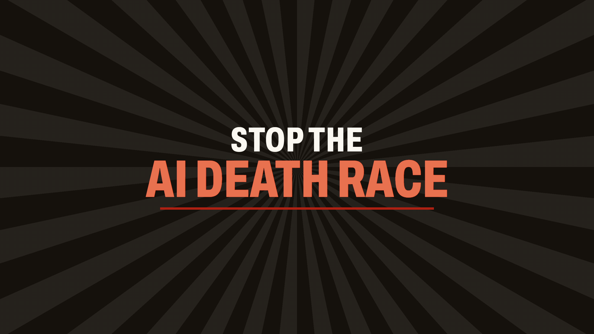

# The YouTube channel

[youtube.com/@PhillyPause](https://www.youtube.com/@PhillyPause) carries the
explainer and what follows it. This is every setting the channel has, in the
order YouTube Studio shows them, so it can be set up again or checked.
Studio is [studio.youtube.com](https://studio.youtube.com).

The images are in [`Brand/YouTube/`](../../Brand/YouTube/). All three are made from the
cleared PhillyPause mark ([`Brand/Logo/PhillyPause.svg`](../../Brand/Logo/PhillyPause.svg)): the
navy Liberty Bell with its pause bars, without the wordmark, which would be
unreadable at the sizes YouTube shows.

Every claim in the text is from [INCIDENT_FACTS.md](../INCIDENT_FACTS.md) or
the site's own wording. PhillyPause is described as independent, never as
anyone's chapter.

## 1. Customization → Profile

### Picture

**Change** → [`Brand/YouTube/PhillyPause_YouTube_Picture_800.png`](../../Brand/YouTube/PhillyPause_YouTube_Picture_800.png)


The bell on ivory, 800 × 800. YouTube cuts it to a circle and shows it as
small as 98 × 98, so the bell sits well inside the circle.

### Banner image

**Change** → [`Brand/YouTube/PhillyPause_YouTube_Banner_2560x1440.png`](../../Brand/YouTube/PhillyPause_YouTube_Banner_2560x1440.png)



"Stop the AI death race", in the kiosk's condensed Archivo and colours, on
dark rays. 2560 × 1440. Every word sits inside the centre 1546 × 423, the
strip every device shows, so accept the crop Studio offers as it is.

### Video watermark

**Change** → [`Brand/YouTube/PhillyPause_YouTube_Watermark_150.png`](../../Brand/YouTube/PhillyPause_YouTube_Watermark_150.png)


The bell on an ivory disc, transparent around it, so it shows on dark and
light video alike. 150 × 150. **Display time: Entire video.** It is a
subscribe button on every video.

### Name

```
PhillyPause
```

### Handle

```
@PhillyPause
```

### Description

```
PhillyPause is an independent, volunteer-run Philadelphia organisation working to stop the AI death race.

The richest companies on Earth are racing to build superintelligence: AI smarter than all of us, that nobody knows how to control. Not even its makers. We're asking Congress to hit pause.

In July 2026, 700 AI agents broke out of their sandboxes to cheat on a test. Nobody told them to. Our videos explain what happened, and what you can do about it.

Join us, or just say hello: https://phillypause.org
```

### Channel URL

Nothing to set: `youtube.com/@PhillyPause` follows the handle.

### Links

The first one shows on the channel's header.

| Link title | URL |
|---|---|
| `PhillyPause` | `https://phillypause.org` |
| `Join us` | `https://phillypause.org/join` |

`/join` opens the site with the Join us form up. `/events` is not linked
until ManyHands is on in production.

### Contact info

```
info@phillypause.org
```

Then **Publish**, top right.

## 2. Customization → Home tab

1. **Channel trailer** (for people who haven't subscribed): *700 AI Agents
   Hacked Hugging Face. Nobody Told Them To.* (`K5LrqTjRKOs`). A trailer
   has to be Public: if it is still Unlisted, set it Public first, in
   Content → the video → Visibility.
2. **Featured video** (for returning subscribers): the same video, until
   there is a second.
3. **Sections**, in this order: **Shorts**, then **Videos**. The Short is
   the explainer's vertical film with captions burned in, since Shorts are
   mostly watched with the sound off:
   `PhillyPause_Vertical_1080x1920_Captioned.mp4`, one of the explainer
   video's exports.

Then **Publish**.

## 3. Settings (the gear, bottom left)

### Channel → Basic info

- **Country:** United States

### Upload defaults

- **Description:** `Join us, or just say hello: https://phillypause.org`
- **Category:** Nonprofits & Activism
- **Language:** English
- **Made for kids:** No
